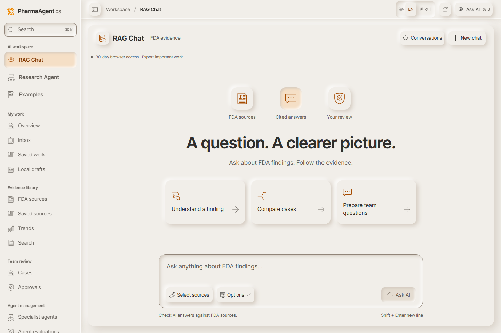
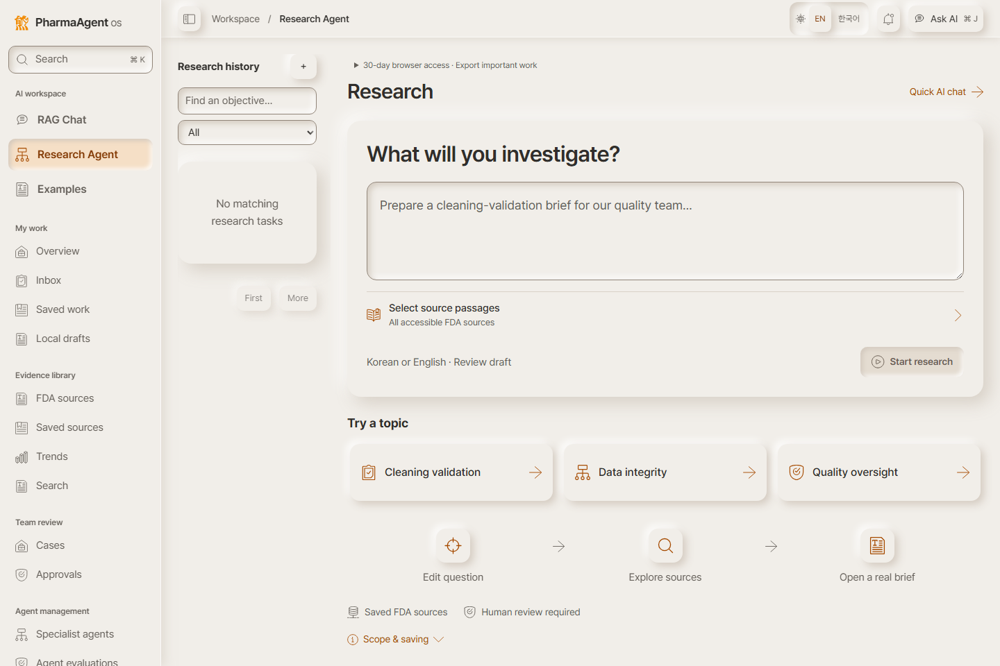
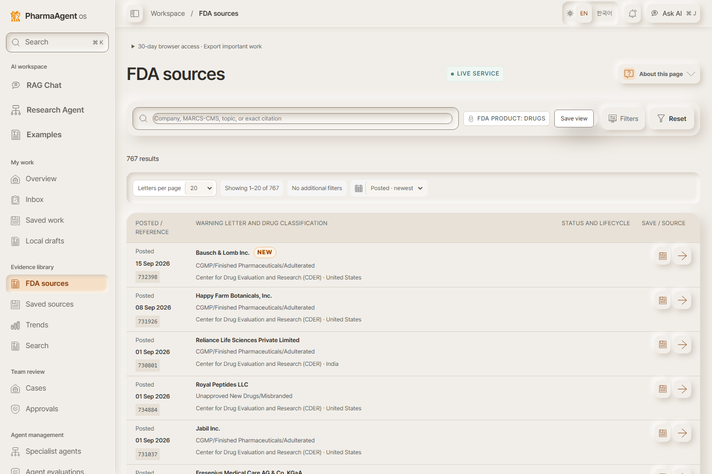
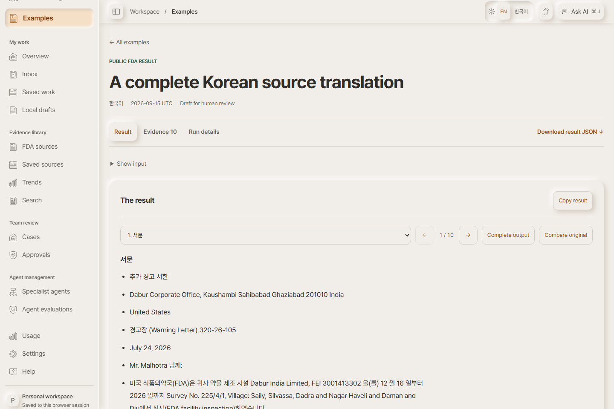
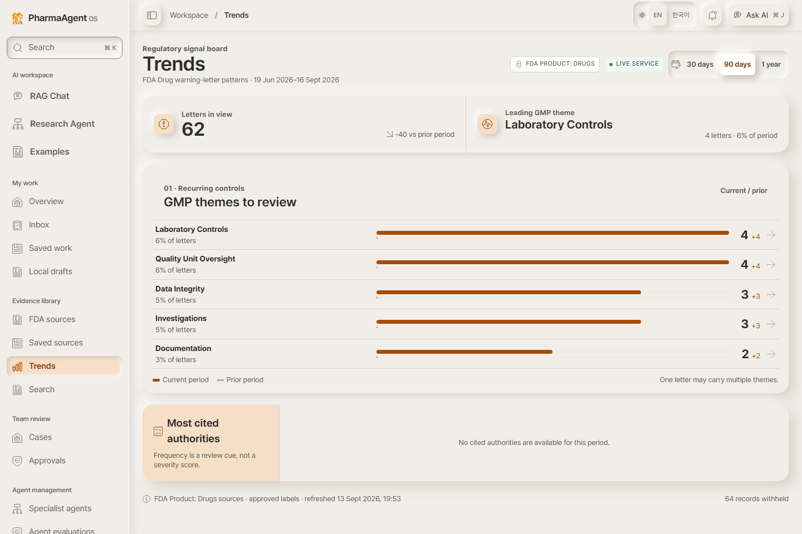
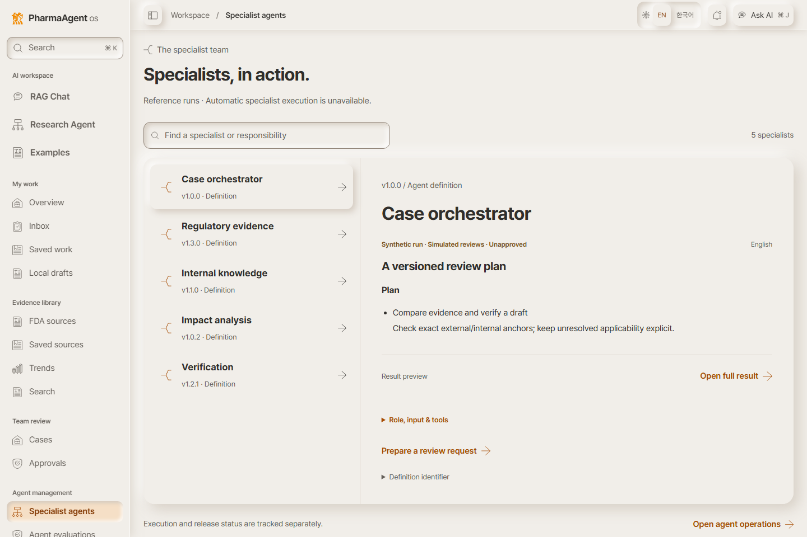
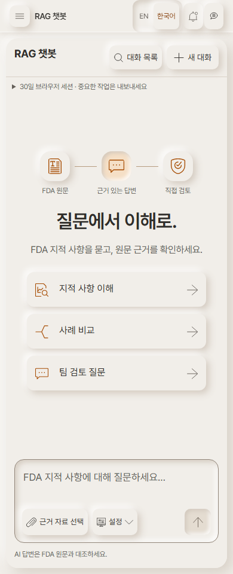
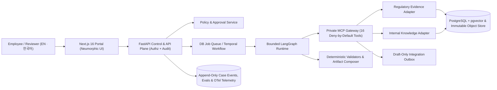

# PharmaAgent OS

**An evidence-first FDA Drug Warning Letter Intelligence & Agentic Regulatory Review Workspace.**

Built with **Next.js 16 (React 19)**, **FastAPI**, **PostgreSQL + pgvector**, **LangGraph**, **Temporal**, and **MCP (Model Context Protocol)** — designed so both regulatory specialists and non-technical employees can explore official U.S. FDA `Product: Drugs` warning letters, run cited AI research, compare bilingual translations side by side against authoritative FDA originals, and govern human-reviewed cases with full provenance.

---

## Key Highlights for Reviewers

- **Evidence-First & Deterministic Scope Control:** AI never decides corpus admission. A deterministic scope gate admits only verified FDA warning letters with canonical metadata `Product: Drugs`, retaining raw bytes and immutable source versions separately from derived summaries and embeddings.
- **Agentic RAG & Bounded Research Agent:** Adaptive retrieval routing skips corpus search for greetings, routes structured queries (dates, counts, links) to catalog metadata, locks dossier follow-ups to pinned letters, and supports `Fast / Balanced / Deep / Auto` model profiles.
- **Governed Multi-Agent Architecture (Milestones 0–8):** 5 versioned specialist agents, 10 skills, and 16 deny-by-default tools across 3 private MCP bundles (`regulatory`, `knowledge`, `workflow`), orchestrated via bounded LangGraph execution inside an optional Temporal outer workflow.
- **Warm Porcelain Neumorphic UI (EN / 한국어):** Full English & Korean interface powered by local Pretendard typography, tactile neumorphic surfaces, reduced-motion & forced-colors accessibility, and section-by-section Korean translation comparison against exact FDA source passages.
- **Production-Grade Verification & CI:** 63 backend `pytest` test modules, 29 frontend unit/component test files, cross-browser Playwright E2E suite (Chromium, Firefox, WebKit), `pgvector` PostgreSQL schema CI, OpenAPI 3.1 / JSON Schema contract validation, and CodeQL scanning.

---

## UI Showcase

### 1. RAG Chat & Citation Flow (Desktop · English)
*Grounded Q&A landing experience with `FDA sources → Cited answers → Your review` workflow, quick task choices, source selector, and model profile controls.*



### 2. FDA Research Agent & Live Source Explorer
| Research Agent Workspace | FDA Sources Explorer (`Product: Drugs`) |
| :---: | :---: |
|  |  |
| *Goal-driven brief generation with topic starters, passage scoping, and history.* | *Server-paginated explorer over 767 retained FDA Drug warning letters with deterministic scope lock.* |

### 3. Bilingual Source Translation & GMP Trends
| Korean Full-Letter Translation & Original Diff | Regulatory Signal Board (GMP Trends) |
| :---: | :---: |
|  |  |
| *Section-by-section Korean translation paired with `Compare original` and JSON export.* | *Period-over-period GMP control themes (Laboratory Controls, Quality Unit Oversight, Data Integrity, Investigations).* |

### 4. Versioned Specialist Agents & Responsive Korean Mobile UI
| Specialist Agent Registry & Plans | Mobile RAG Chatbot (한국어) |
| :---: | :---: |
|  |  |
| *5 versioned agents (`Case orchestrator`, `Regulatory evidence`, `Internal knowledge`, `Impact analysis`, `Verification`) with explicit synthetic/unapproved labeling.* | *Full Korean localization (`질문에서 이해로.`) and mobile-first responsive layout.* |

---

## Core Capabilities

### 1. Authoritative FDA Acquisition & Lifecycle Pipeline
- Controlled FDA acquisition enforcing host/IP validation, redirect limits, response bounds, `robots.txt` & crawl-delay compliance, and FDA DataTables JSON/HTML discovery.
- Configurable three-year discovery/backfill window with an auditable five-year soft-retirement gate (removes aged letters from active search/RAG without deleting retained source evidence).
- Idempotent `NEW` / `UPDATED` notification outbox with SMTP disabled by default in local/test environments.

### 2. Cited RAG Chat, Letter Dossiers & Bilingual Translation
- **RAG Chat (`Ask AI`):** Source-grounded answers with clickable citations linked to exact retained FDA passage anchors.
- **Drug Letter Dossiers:** Persists validated Korean full-letter translations, structured GMP findings, and practical summaries against the exact `DocumentVersion`, enabling letter-constrained follow-up chat.
- **Bilingual Switch (`EN` / `한국어`):** Entire navigation, workflows, and controls switch dynamically while keeping official FDA source text authoritative.
- **Account-Free Viewer Access + Role Controls:** Public visitors browse with isolated 30-day anonymous browser sessions (`viewer` role); case creation, formal approvals, and admin operations remain role-protected.

### 3. PharmaAgent OS — Governed Multi-Agent & MCP Platform
- **5 Versioned Agents** (`contracts/agents/`): `case-orchestrator` (`v1.0.0`), `regulatory-evidence-agent` (`v1.3.0`), `internal-knowledge-agent` (`v1.1.0`), `impact-analysis-agent` (`v1.0.2`), and `verification-agent` (`v1.2.1`).
- **3 Private MCP Tool Bundles** (`contracts/tools/`): `regulatory-mcp`, `knowledge-mcp`, and `workflow-mcp` exposing 16 deny-by-default tools and 10 versioned skills (`contracts/skills/`).
- **Durable Execution & Assurance:** Bounded LangGraph runtime with optional Temporal outer workflow, deterministic schema validators with bounded retries, Control Tower telemetry & kill switches, multi-trial evaluation gates, and draft/read-only Email, Slack/Teams, Notion, and A2A integrations.

---

## Architecture Overview



### Design & Safety Boundaries
- **Deterministic Admission:** Only verified `Product: Drugs` records enter active search/RAG; `UNVERIFIED`, `AMBIGUOUS`, and `OUT_OF_SCOPE` documents are blocked.
- **Untrusted Input Isolation:** Raw FDA HTML and attachments are sanitized and never rendered directly.
- **ACL-Before-Retrieval:** Authorization and corpus filters execute before lexical (FTS) and 1,536-dim `pgvector` retrieval.
- **Decision Support Boundary:** The platform supports regulatory intelligence and human review; it does not declare noncompliance, initiate CAPA, or mutate controlled QMS/EDMS/MES/LIMS records.

---

## Tech Stack

| Layer | Technologies |
| :--- | :--- |
| **Frontend** | Next.js `16.3`, React `19.2`, TypeScript `5.9`, TanStack Query `5`, Motion `13`, Pretendard Variable Font, `jose` |
| **Backend & Agents** | Python `3.12+`, FastAPI, SQLAlchemy `2.0` (`asyncpg` / `aiosqlite`), Pydantic Settings, LangGraph, Temporalio, OpenTelemetry |
| **Data & Vector Search** | PostgreSQL `16` + `pgvector` (1,536-dim embeddings + FTS), Versioned S3-compatible/MinIO Object Storage, Redis |
| **Contracts & Schemas** | OpenAPI `3.1` (`contracts/api_contract.yaml`), JSON Schema, SQL DDL (`contracts/schema.sql`), Versioned YAML Agent/MCP Specs |
| **Testing & CI** | `pytest` (63 modules), `ruff`, `vitest` (29 test files), Playwright (Chromium/Firefox/WebKit), GitHub Actions + CodeQL |

---

## Repository Map

```text
apps/web/             Next.js portal (App Router, neumorphic design system, Vitest + Playwright)
services/api/         FastAPI service, FDA ingestion, RAG router, MCP servers, LangGraph/Temporal workers, pytest suite
contracts/            SQL schema, OpenAPI 3.1 spec, AI summary schema, taxonomy, agent/skill/MCP YAML contracts
fixtures/             Explicitly labeled fictional development & evaluation fixtures
infra/                Docker Compose (PostgreSQL/pgvector, Redis, MinIO) and Railway/Vercel deployment configs
docs/                 ADRs, logical & agent-platform architecture, threat model, runbooks, UI assets
tests/fixtures/       Shared source fixtures and negative scope examples
```

---

## Quick Local Setup

### 1. Optional Infrastructure Services (PostgreSQL/pgvector, Redis, MinIO)
> The API defaults to SQLite and local immutable object storage, so Docker is optional for a quick first run.

```powershell
Copy-Item infra/local/.env.example infra/local/.env
# Replace local-only password placeholders before starting
docker compose --env-file infra/local/.env -f infra/local/compose.yaml up -d --wait
```

### 2. Backend API (`services/api`)
```powershell
cd services/api
py -3.13 -m venv .venv
.\.venv\Scripts\Activate.ps1
python -m pip install -e ".[dev]"
python -m app.cli init-db
python -m app.cli seed-demo
uvicorn app.main:app --reload --port 8000
```

> **Optional Grounded AI / Embeddings:** Keep credentials in `services/api/.env` (gitignored), set `LLM_PROVIDER=gemini` (or approved provider) and `EMBEDDING_ENABLED=true`. See `services/api/README.md` for details.

### 3. Web Portal (`apps/web`)
```powershell
cd apps/web
Copy-Item .env.example .env.local
npm install
npm run dev
```

Open **`http://localhost:3000`**. Use the header `EN` / `한국어` toggle to switch languages. When the backend API is offline, the portal clearly displays its isolated preview state and fails closed on live grounded chat.

### 4. Quality & Test Suites
```powershell
# Backend lint & tests
cd services/api
.\.venv\Scripts\ruff.exe check app tests
.\.venv\Scripts\pytest.exe

# Frontend lint, typecheck, unit tests & production build
cd ..\..\apps\web
npm run lint
npm run typecheck
npm test
npm run build

# Cross-browser Playwright verification (Chromium, Firefox, WebKit)
npx playwright install chromium firefox webkit
npm run test:browser
```

---

## Architecture & Assurance Documentation

- **Product & Visual Design:** [`PRODUCT.md`](PRODUCT.md) · [`DESIGN.md`](DESIGN.md) · [`docs/product/UX_SPEC.md`](docs/product/UX_SPEC.md) · [`docs/product/PHARMA_AGENT_OS_SPEC.md`](docs/product/PHARMA_AGENT_OS_SPEC.md)
- **Architecture & ADRs:** [`docs/architecture/logical-architecture.md`](docs/architecture/logical-architecture.md) · [`docs/architecture/agent-platform.md`](docs/architecture/agent-platform.md) · [`docs/architecture/agentic-rag-and-chat.md`](docs/architecture/agentic-rag-and-chat.md) · [`docs/adr/`](docs/adr/)
- **Security & Handover:** [`SECURITY_CONTROL_MATRIX.md`](SECURITY_CONTROL_MATRIX.md) · [`HANDOFF.md`](HANDOFF.md) · [`PHARMA_AGENT_OS_IMPLEMENTATION_HANDOFF.md`](PHARMA_AGENT_OS_IMPLEMENTATION_HANDOFF.md) · [`docs/assurance/launch-readiness-20260906.md`](docs/assurance/launch-readiness-20260906.md)
